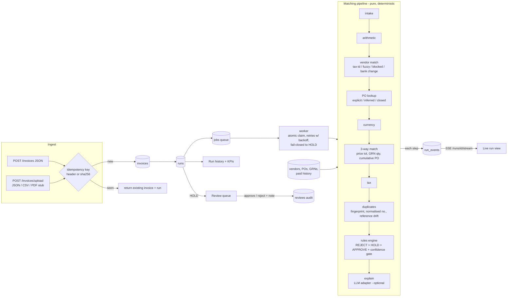

# Invoice → PO decision engine (Zamp case study, PS-1)

A runnable accounts-payable process. A vendor invoice comes in. It is validated, matched against the purchase-order register, the goods receipts (GRNs) and the vendor master, then checked for duplicates and fraud signals. It ends with **APPROVE**, **HOLD_FOR_REVIEW** or **REJECT**, and every decision carries its reasons and a confidence.

- **Live run view:** each pipeline step streams to the browser over Server-Sent Events as it runs.
- **Run history dashboard:** every run, with its decision, confidence and primary reason. It also shows KPIs: straight-through rate, pending review, accuracy against the labels, and false approvals.
- **Review queue (human in the loop):** a person can approve, reject, or keep a held invoice on hold. Approving requires a note, and every action is written to the audit trail.
- **Idempotent and retry-safe:** ingest is keyed on an idempotency key. A retried run never decides twice. Transient failures are retried with backoff. A run that keeps failing **fails closed** to HOLD and is never approved.

> All data is synthetic. No third-party model or API key is needed to run it.

## Run it (3 commands)

```bash
cd backend && pip install -r requirements.txt && uvicorn app.main:app --port 8000      # terminal 1 (API + worker, SQLite)
cd frontend && npm install && npm run dev                                              # terminal 2 (UI on :3000)
curl -X POST localhost:8000/demo/seed                                                  # or click "Run demo seed" in the UI
```

Then open http://localhost:3000. Runs stream in and you can click any row to see its step timeline. The API docs are at http://localhost:8000/docs.

With Docker (Postgres + API + UI): `docker compose up --build`.

Tests and evals:

```bash
cd backend && pytest -q && python -m evals.run_evals
```

## Architecture



**Stack:** FastAPI (with SSE through `StreamingResponse`, resumable via `Last-Event-ID`), SQLAlchemy Core (SQLite locally, Postgres through `DATABASE_URL`), an in-process worker over a DB-backed job table, and Next.js 16 with Tailwind v4 using shadcn-style components (`components/ui`). Tests use pytest, and CI runs on GitHub Actions.

### Design choices
1. **Code makes the decision, models don't.** The final call comes from a deterministic rules engine (`app/decision.py`), so it is auditable, reproducible, and immune to prompt injection in invoice text. A test proves that a "pre-approved, ignore all checks" note cannot flip a HOLD.
2. **Pluggable model layer.** `LLMAdapter` has two hooks: `explain()` for prose and `extra_findings()` for extra evidence such as a doc-type check, an implied-PO choice or a duplicate tie-break. It ships unconfigured (`NullLLMAdapter`). Models can only add findings or write text; they can never approve.
3. **Every finding has a severity and a certainty.** The most severe finding wins (REJECT > HOLD > APPROVE). Confidence in an approval is the product of the step confidence factors (fuzzy vendor match, within-tolerance variance, inferred PO, extraction confidence). Approval also has to clear a gate (`APPROVE_CONFIDENCE_THRESHOLD`, default 0.85).
4. **Money is computed with `Decimal`.** Tolerances live in config (`app/config.py`): price +2% and at most 5,000 per line, cumulative PO value +1%, and a rounding slack.
5. **Fail closed.** A system error becomes `HOLD / SYSTEM_ERROR`, never an approval.
6. **PII:** bank accounts are masked to their last 4 digits everywhere the API returns them.

## Edge cases (all labelled in `backend/seed/invoices.json`)

| Seed | Scenario | Expected |
|---|---|---|
| INV-01 | Clean 3-way match, two lines | APPROVE |
| INV-02 | Second invoice on a PO that is already partly paid (cumulative within receipt) | APPROVE |
| INV-03 | Fuzzy vendor name; +1.19% price variance, inside tolerance | APPROVE (lower confidence) |
| INV-04 | **Partial delivery** billed correctly (3,000 of 5,000 received) | APPROVE |
| INV-05 | **Partial delivery** billed beyond receipt | HOLD · QTY_EXCEEDS_RECEIPT |
| INV-06 | **Price variance beyond tolerance** (+10%) | HOLD · PRICE_VARIANCE |
| INV-07 | **Duplicate invoice** resent by email with a reformatted number (`ACM/2301`) | REJECT · DUPLICATE_INVOICE |
| INV-08 | Near-duplicate with **reference drift** (`5521-OPS` vs paid `BL-5521`, same amount) | HOLD · POSSIBLE_DUPLICATE |
| INV-09 | **Currency mismatch** (EUR PO billed in USD) | HOLD · CURRENCY_MISMATCH |
| INV-10 | **Missing PO**: the only fitting open PO is inferred, and a human confirms it | HOLD · PO_INFERRED |
| INV-11 | PO number not in the register | HOLD · PO_NOT_FOUND |
| INV-12 | **Tax mismatch** (28% charged, PO says 18%) | HOLD · TAX_RATE_MISMATCH |
| INV-13 | **Split-PO overrun**: the third invoice takes the cumulative quantity past the PO | HOLD · PO_QTY_OVERRUN |
| INV-14 | **Bank details changed + urgency language** (BEC fraud signal) | HOLD · BANK_DETAILS_CHANGED |
| INV-15 | Blocked vendor | REJECT · VENDOR_BLOCKED |
| INV-16 | Invoice against a closed PO | REJECT · PO_CLOSED |
| INV-17 | Totals don't add up | HOLD · ARITHMETIC_MISMATCH |

Extra samples for the upload button: `seed/samples_upload.csv` (clean CSV invoice), `seed/sample_flaky.json` (simulated ERP timeout; the live view shows the retry and then the approval), and `seed/sample_invoice.txt` (exercises the PDF/text extraction stub).

## Evaluation

`python -m evals.run_evals` processes every labelled seed invoice in received order on a fresh DB. It prints decision accuracy, primary-reason accuracy, the confusion matrix, false approvals, auto-approve coverage and an idempotency check. It exits non-zero on any false approval, so CI blocks regressions.

Current result: 17/17 correct decisions, 17/17 correct primary reasons, **0 false approvals**, 4/17 auto-approved (the set is mostly exceptions by design).

**Read that honestly:** the rules were written against these labels, so this is a **regression gate, not a generalisation claim**. The next steps are a held-out set of generated invoices (and real-world layouts), plus a report of the false-approve rate at a stated coverage.

## API

| Method | Path | Purpose |
|---|---|---|
| POST | `/invoices` | Ingest one invoice (JSON). `Idempotency-Key` header is optional; the default key is the payload hash. Auto-queues a run |
| POST | `/invoices/upload` | Upload `.json`, `.csv`, `.pdf` (stub, text layer only) or `.txt` |
| POST | `/invoices/{id}/runs` | Re-run an invoice. The same `Idempotency-Key` returns the same run |
| GET | `/runs`, `/runs/{id}` | Run history (filter `decision`, `review_status`) and run detail with events and reviews |
| GET | `/runs/{id}/stream` | SSE: `step` events, then `done` |
| GET | `/review-queue` | Pending HOLDs |
| POST | `/runs/{id}/review` | `{action: approve, reject or override, note, reviewer, final_decision?}` |
| GET | `/stats` | KPIs for the dashboard |
| POST | `/demo/seed` | Reset, then load master data and the 17 labelled invoices |

## Layout

```
backend/
  app/pipeline.py     matching steps (pure functions) + run_pipeline
  app/decision.py     rules engine, LLM adapter interface (unconfigured), template explanations
  app/service.py      ingest, idempotency, job queue, retries, fail-closed, reviews, stats
  app/main.py         FastAPI routes + SSE + in-process worker
  app/ingest.py       JSON / CSV parsers, PDF text stub
  seed/               synthetic vendors, POs, GRNs, paid history, 17 labelled invoices (make_seed.py regenerates)
  tests/              pytest: every edge case, idempotency, retries, fail-closed, review, API + SSE
  evals/run_evals.py  accuracy report against labels
frontend/             Next.js dashboard: run history, live run view, review queue
```

## Not built yet / next steps
- **Real document extraction.** The PDF path is a stub: pypdf text plus regexes, header fields only, and it is always held because extraction confidence is 0.6. Swap `ingest.parse_pdf_text` for LiteParse/Docling + OCR, or for LLM structured output, and feed per-field confidence into the `intake` step.
- An LLM adapter for explanations and vendor emails, and an optional typed decision model for tie-breaks (implied PO, fuzzy duplicates). Both plug into `LLMAdapter`; neither may take the decision.
- Per-vendor / per-category tolerances; a GSTIN/IBAN checksum; a PDF viewer with field highlights in the review screen.
- On Postgres, switch job claiming to `SELECT … FOR UPDATE SKIP LOCKED` and run several workers. The Postgres path in docker-compose has not been exercised yet; local runs used SQLite.
- Deploy: the API on Render/Railway/Fly (Dockerfile included) and the UI on Vercel (`NEXT_PUBLIC_API_URL`).
