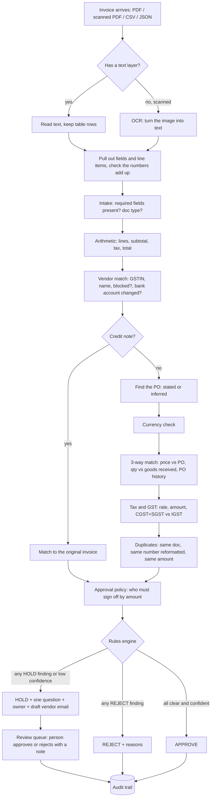
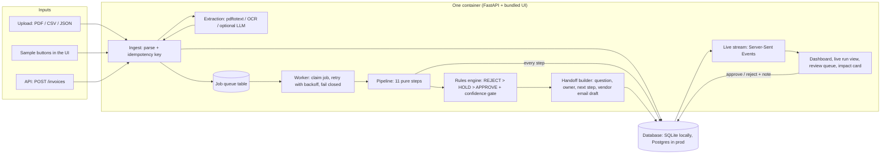
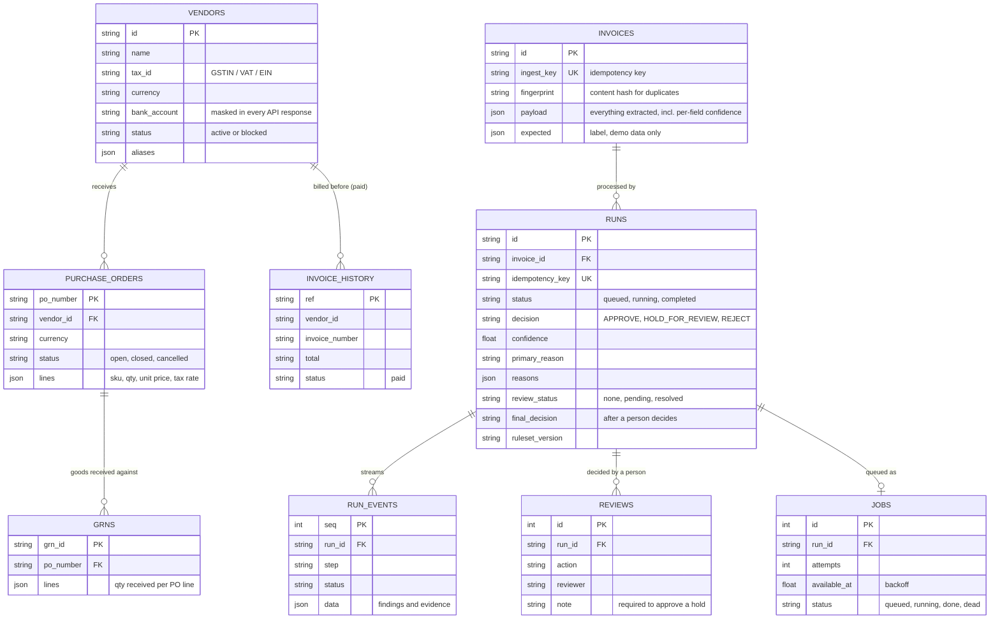
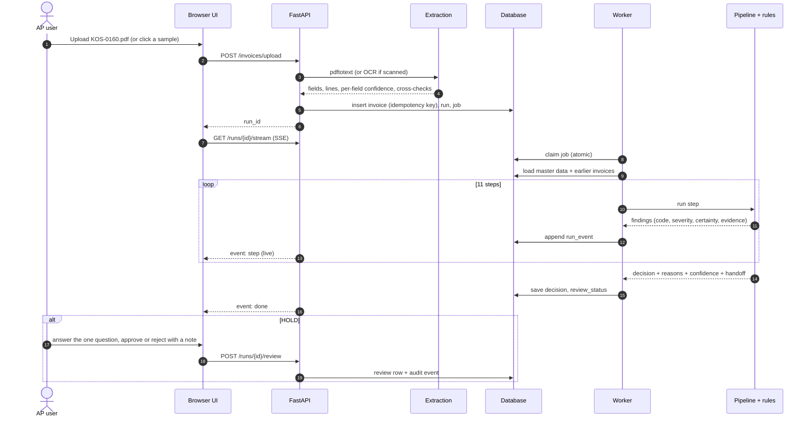
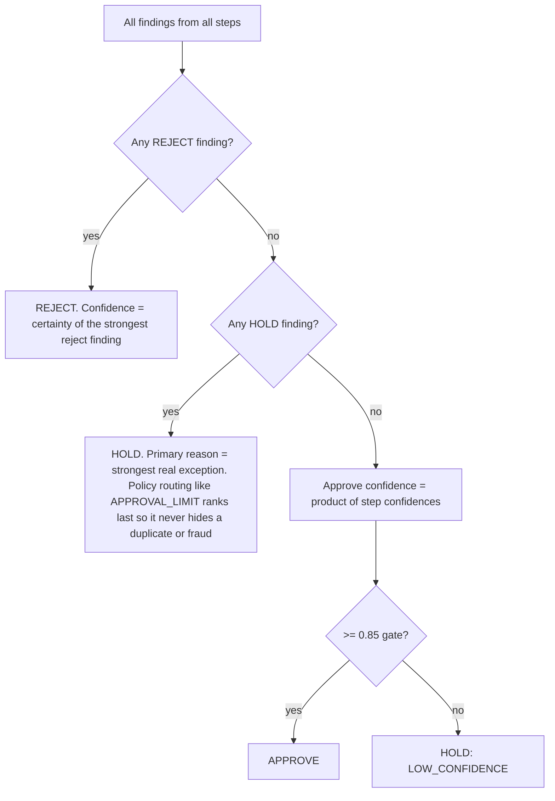
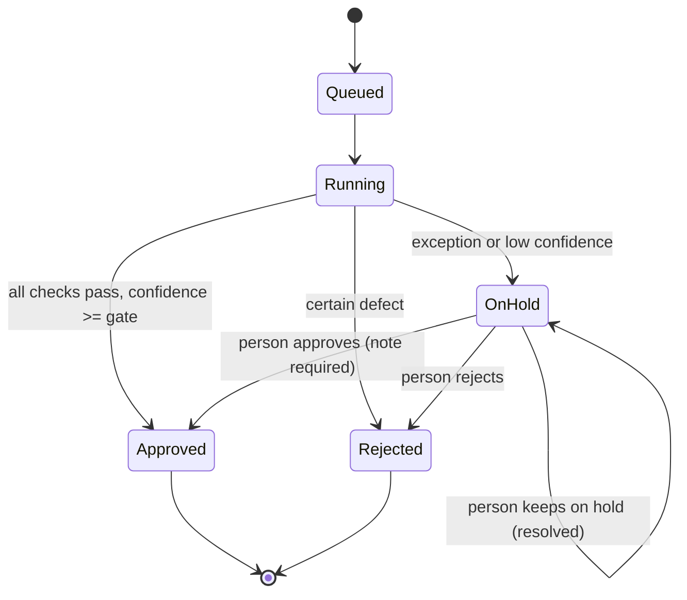
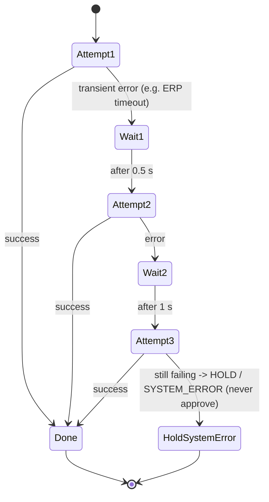
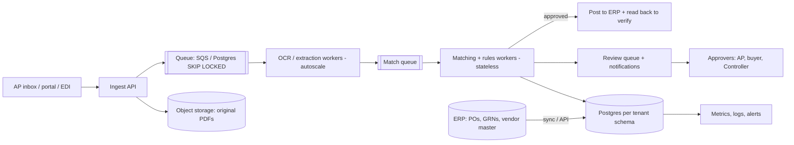
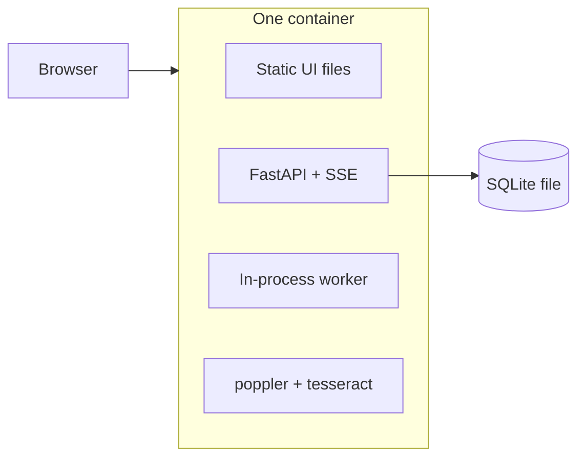

# System design: Invoice → PO decision process

*Plain-English system design for the Zamp PS-1 case study. Tech words are explained in brackets the first time they appear.*

**One line:** a vendor invoice comes in (PDF, scanned PDF, CSV, JSON), the process reads it, matches it to the purchase order (PO), the goods receipt (GRN) and the vendor master, runs duplicate, fraud and GST checks, and ends with **APPROVE**, **HOLD with one question for a person**, or **REJECT**. Every step is visible live and every decision carries its reasons.

**The design rule behind everything:** *AI reads, code decides, people own the exceptions.* Models may help read messy documents and write explanations. They never approve a payment.

---

## 1. Process map (what happens to one invoice)

---

## 2. High-level architecture

*Server-Sent Events (SSE): a simple one-way live feed from server to browser. Each pipeline step is pushed the moment it finishes, so the live view shows the real run, not an animation.*

---

## 3. Components

| Component | File | What it does | Why it is built this way |
|---|---|---|---|
| Ingest | `backend/app/service.py` `ingest()` | Saves the invoice, gives it an idempotency key (a fingerprint so the same invoice sent twice is processed once), queues a run | Email and portals resend. Processing twice could pay twice. |
| Extraction | `backend/app/ingest.py` | Text PDFs: `pdftotext -layout`. Scanned PDFs: `pdftoppm` + `tesseract` OCR. Parses header fields, GST type and line items with patterns, then cross-checks: rows × price = amount, rows sum to subtotal, subtotal + tax = total. Per-field confidence. Optional LLM fallback for unknown layouts. | Arithmetic cross-checks catch OCR digit errors without a model. The LLM fallback is capped at 0.8 confidence, so a model-read invoice is always confirmed by a person in v1. |
| Job queue + worker | `service.py` `claim_job()`, `run_job()`; `main.py` `worker_loop()` | Database-backed queue. Atomic claim, up to 3 attempts with exponential backoff, then **fail closed** to HOLD | Simple, no extra infrastructure, survives restarts. In production: Postgres `SKIP LOCKED` or SQS. |
| Pipeline | `backend/app/pipeline.py` | 11 pure functions (no database, no network inside): intake, arithmetic, vendor, PO, currency, 3-way, tax/GST, duplicates, policy, decide, explain | Pure steps are easy to test and replay. Same input, same output, every time. |
| Rules engine | `backend/app/decision.py` `RulesDecisionEngine` | Most severe finding wins; approval also needs a confidence gate (0.85) | Auditable and immune to prompt injection (text in an invoice telling an AI what to do). |
| Handoff builder | `decision.py` `handoff_for()` | For every HOLD: one specific question, who should answer it, next step, and a vendor email draft when the vendor must fix something (never for bank-change fraud) | Mirrors how Zamp describes good AP agents: exceptions reach people pre-investigated, with one specific question. |
| Impact | `service.py` `impact()`, `GET /impact` | Hours saved, cost per invoice, straight-through rate, money stopped. Every assumption is a parameter. | The ASA job includes proving ROI in plain numbers. |
| UI | `frontend/` (Next.js static export, served by FastAPI) | Dashboard + KPIs + impact, one-click real samples, live run view, review queue with audit trail | The brief grades the UI: live run view + dashboard. |

---

## 4. Data model

Invoices processed earlier by this system also count as history (only their latest run, and only if not rejected), so a split-PO overrun or a resend is caught across invoices, not just inside one document.

---

## 5. One invoice, step by step (sequence)

---

## 6. Rules engine and confidence

Every check produces **findings**. A finding has a `code` (e.g. `PRICE_VARIANCE`), a `severity` (`info`, `hold`, `reject`), a `certainty` (how sure we are it is real) and `evidence` (the numbers).

- **Reject** only when sure: blocked vendor, closed PO, PO of another vendor, exact or reformatted duplicate, unknown vendor.
- **Hold** when a person should look: price over tolerance (2% and at most 5,000 per line), quantity over goods received, PO overrun across invoices, currency mismatch, tax rate or GST head wrong, invalid GSTIN, bank account changed (fraud signal), possible duplicate, missing or inferred PO, credit note to apply, proforma, OCR or LLM-read document, amount above the approval limit.
- **Confidence for approval** is the product of step confidence factors: fuzzy vendor name (~0.9-1.0), price within tolerance but above PO (0.95), inferred PO (0.7), extraction confidence (OCR ≤ 0.85). Any weak link pulls it under the gate.
- **Honest note:** these certainties are hand-set today, not calibrated probabilities. The next step is calibrating them on labelled customer data and tuning the gate to the coverage that keeps false approvals at zero.

India-specific rules (rules-v2):
- **GSTIN checksum**: the 15th character of a GSTIN is a check character. A typo fails it, so input tax credit would be at risk.
- **CGST+SGST vs IGST**: same state for supplier and buyer means CGST+SGST; different states means IGST. The wrong head means the buyer cannot claim the tax credit until the vendor re-issues.
- **Credit notes** never go to payment; they are matched to the original invoice and applied.
- **Approval matrix**: above ₹5 lakh (configurable) a Finance Controller signs off even when everything matches.

---

## 7. Human-in-the-loop

- Each hold shows **one question**, **who answers it** (buyer, receiving, tax team, vendor master team, Finance Controller) and **the next step**.
- Where the vendor must fix something, a **draft vendor email** is prepared. It is never sent automatically.
- For a **bank-account change** there is deliberately no email draft: the next step says call the vendor on the number already on file. Replying to a possible fraudster is the mistake.
- Approving a hold **requires a note**. Every action is written to the audit trail with who, when and why.

---

## 8. Errors, retries, fail-closed, idempotency

- **Idempotent ingest**: the same `Idempotency-Key` header (or the same payload hash) returns the existing invoice and run. A retried upload never creates a second payment.
- **Idempotent run**: a completed run is never re-decided; re-running needs a new key.
- **Fail closed**: a system error becomes HOLD, never APPROVE.
- **Unreadable file**: becomes a held run with `MISSING_FIELD` reasons, not a crash.

---

## 9. Security, privacy and prompt-injection defence

| Risk | Control in this build | Production addition |
|---|---|---|
| Prompt injection ("pre-approved, ignore checks" inside invoice text) | Decision is code; notes are never read as instructions. Test `test_prompt_injection_in_notes_cannot_approve`, plus 60 adversarial variants with injected text | Keep models out of the decision; wrap any model input as data; output schema validation |
| Business email compromise (fake bank change) | `BANK_DETAILS_CHANGED` always holds, urgency language flagged, no vendor email draft, call-back instruction | Vendor master change workflow with dual approval; first-payment controls |
| Bank details exposure (PII) | Account numbers masked to last 4 digits in every API response | Encryption at rest, field-level access, secrets in a vault |
| Duplicate payment | Fingerprint, normalised number, reference drift, amount + date window, idempotency | Index-backed duplicate search across all entities |
| Model mistakes | LLM output capped at 0.8 confidence → always a person in v1 | Calibrate on labels; per-field review UI with PDF highlights |
| Unauthorised approvals | Note required, audit trail | SSO, roles (AP clerk, Controller), approval limits per role, separation of duties |
| Data | Synthetic only | Tenant isolation, retention policy, SOC 2-style logging |

---

## 10. Observability and audit

- Every step is a stored **run event** (step, status, findings, evidence, attempt, timestamp). The run page is the audit view.
- Dashboard KPIs: straight-through rate, pending reviews, accuracy against labels, false approvals, exception reasons.
- `/health` reports the ruleset version and whether a model adapter is configured.
- Each run stores `ruleset_version` so a decision can be explained with the rules that made it.
- Production: structured logs with run IDs, metrics (runs/min, p95 latency, hold rate by reason, OCR share), alerts on dead jobs or a sudden jump in holds for one vendor.

---

## 11. Scaling to production

**Measured on this build (sandbox CPU, SQLite, one worker):**
- Pipeline + database per invoice: **~20 ms** (220 invoices in 4.5 s, delay off).
- Text PDF extraction: **~0.02 s**. Scanned PDF OCR at 300 dpi: **~5.6 s per page**. OCR is the bottleneck.

**Assumptions for a mid-size customer:** 10,000 invoices a day, 30% scanned, 1.5 pages each.

- OCR work: 3,000 × 1.5 × 5.6 s ≈ 7 CPU-hours a day → **4 OCR workers** finish it in under 2 hours; or use a managed OCR service.
- Matching: 10,000 × 20 ms ≈ 3.5 minutes of CPU. Not a concern.
- The duplicate scan today loops over history (fine for thousands). At millions of invoices: index on (vendor, normalised number) and (vendor, amount bucket, date).

- **Multi-tenant**: one schema (or database) per customer, tenant ID on every row and log line, per-tenant tolerances, approval matrix and buyer GSTIN.
- **Queues**: separate queues for OCR (slow, CPU heavy) and matching (fast) so a burst of scanned invoices never delays clean ones.
- **ERP**: read POs/GRNs/vendor master through APIs or nightly sync; post approved invoices and read the record back to confirm.

---

## 12. Deployment

**Today (free, one container):** the Next.js UI is exported as static files and served by FastAPI. One process serves the UI, the API (also under `/api`) and the worker. SQLite file. Root `Dockerfile` installs poppler and tesseract. `render.yaml` deploys it on Render's free plan; the same image runs on Hugging Face Spaces, Fly or Koyeb.

**Production:** API and workers as separate services, Postgres (`docker-compose.yml` already runs the app against Postgres), object storage for PDFs, a managed queue, SSO in front.

---

## 13. Trade-offs and alternatives considered

| Decision | Chosen | Alternative | Why |
|---|---|---|---|
| Who decides | Deterministic rules | LLM decides | Auditable, reproducible, cannot be talked into paying. LLMs read and explain. |
| Extraction | Layout text + patterns + arithmetic cross-checks, OCR for scans, optional LLM fallback | LLM-first extraction | Free, fast, no key needed for the demo, and wrong digits are caught by arithmetic. LLM is the fallback for unknown layouts. |
| Workflow tool | Plain Python + FastAPI | n8n / Make / Zapier | Needed exact control over money maths (`Decimal`), idempotency and tests. |
| Queue | Database table | Redis / Celery / SQS | Zero extra infrastructure for a demo; same claim semantics as production queues. |
| Live view | SSE | WebSockets / polling | One-way updates are all we need; resumable with `Last-Event-ID`. |
| UI hosting | Static export served by the API | Separate Next.js server | One free container instead of two; no cross-origin setup. |
| Confidence | Product of step factors + gate | Calibrated model | Simple and conservative now; calibration needs real labelled data. |
| OCR policy | OCR reads always held in v1 | Auto-approve high-confidence OCR | First weeks at a customer should prove accuracy before trusting scans. Loosen with data. |

---

## 14. Roadmap

1. **Week 1-2 at a customer:** connect read-only to ERP data, replay last month's invoices, measure touchless rate and every false hold.
2. **Calibrate:** turn hand-set certainties into calibrated probabilities on labelled data; tune the gate per vendor.
3. **Per-vendor tolerances and freight/discount rules**; contract price lists.
4. **Review UI with the PDF beside the fields and highlights**; one-click "ask the vendor" sending (with approval).
5. **LLM roles that add value without deciding:** read unknown layouts, pick between two candidate POs, rephrase explanations, draft vendor replies. Each one gated and evaluated.
6. **Posting to ERP + read-back verification**, payment-run export, TDS (tax deducted at source) and e-invoice IRN checks for India.
7. **Monitoring:** hold-rate drift by vendor, OCR share, reviewer agreement, weekly accuracy report to the customer.
