# System design: Invoice → PO decision process

*Plain-English system design for the Zamp PS-1 case study. Tech words are explained in brackets the first time they appear.*

**One line:** a vendor invoice comes in (PDF, scanned PDF, CSV, JSON), the process reads it, matches it to the purchase order (PO), the goods receipt (GRN) and the vendor master, runs duplicate, fraud and GST checks, and ends with **APPROVE**, **HOLD with one question for a person**, or **REJECT**. Every step is visible live and every decision carries its reasons.

**The design rule behind everything:** *AI reads, code decides, people own the exceptions.* Models may help read messy documents, match, and explain. They never approve a payment; an uncertain answer goes to a person.

**New in this version (rules-v3):** every decision cites its **evidence** from named **systems of record** (section 3a); source **freshness and conflict** checks; the **Jev** model from TypeSafe as a switchable, advisory helper (section 6a, measured in [EVALS.md](EVALS.md)); and production switches that are off by default (section 9a). **Also new:** a guardrails layer and threat model (section 9b, [SECURITY.md](SECURITY.md)) and one evaluation harness with an LLM-as-judge and a regression gate (section 10a).

---

## 1. Process map (what happens to one invoice)

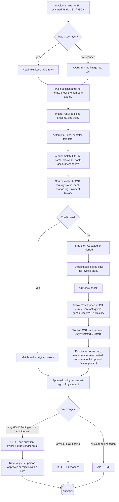

---

## 2. High-level architecture

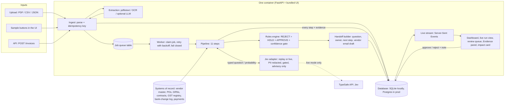

*Server-Sent Events (SSE): a simple one-way live feed from server to browser. Each pipeline step is pushed the moment it finishes, so the live view shows the real run, not an animation.*

---

## 3. Components

| Component | File | What it does | Why it is built this way |
|---|---|---|---|
| Ingest | `backend/app/service.py` `ingest()` | Saves the invoice, gives it an idempotency key (a fingerprint so the same invoice sent twice is processed once), queues a run | Email and portals resend. Processing twice could pay twice. |
| Extraction | `backend/app/ingest.py` | Text PDFs: `pdftotext -layout`. Scanned PDFs: `pdftoppm` + `tesseract` OCR. Parses header fields, GST type and line items with patterns, then cross-checks: rows × price = amount, rows sum to subtotal, subtotal + tax = total. Per-field confidence. Optional LLM fallback for unknown layouts. | Arithmetic cross-checks catch OCR digit errors without a model. The LLM fallback is capped at 0.8 confidence, so a model-read invoice is always confirmed by a person in v1. |
| Job queue + worker | `service.py` `claim_job()`, `run_job()`; `main.py` `worker_loop()` | Database-backed queue. Atomic claim, up to 3 attempts with exponential backoff, then **fail closed** to HOLD | Simple, no extra infrastructure, survives restarts. In production: Postgres `SKIP LOCKED` or SQS. |
| Pipeline | `backend/app/pipeline.py` | 11 step functions (no database inside; the only network call is the optional, gated Jev question): intake, arithmetic, vendor, PO, currency, 3-way, tax/GST, duplicates, policy, decide, explain | Pure steps are easy to test and replay. Same input, same output, every time. |
| Rules engine | `backend/app/decision.py` `RulesDecisionEngine` | Most severe finding wins; approval also needs a confidence gate (0.85) | Auditable and immune to prompt injection (text in an invoice telling an AI what to do). |
| Handoff builder | `decision.py` `handoff_for()` | For every HOLD: one specific question, who should answer it, next step, and a vendor email draft when the vendor must fix something (never for bank-change fraud) | Mirrors how Zamp describes good AP agents: exceptions reach people pre-investigated, with one specific question. |
| Impact | `service.py` `impact()`, `GET /impact` | Hours saved, cost per invoice, straight-through rate, money stopped. Every assumption is a parameter. | The ASA job includes proving ROI in plain numbers. |
| UI | `frontend/` (Next.js static export, served by FastAPI) | Dashboard + KPIs + impact, one-click real samples, live run view, review queue with audit trail | The brief grades the UI: live run view + dashboard. |

---

## 3a. Sources of truth and evidence

A decision is only as good as the records it was checked against. This version names each **system of record**, takes a snapshot time ("as of") for each, and makes every check write an **evidence record**.

| System of record | In production | In this demo | Checks that read it |
|---|---|---|---|
| Invoice document | the PDF / e-invoice as received | PDF text, OCR, CSV, JSON | required fields, arithmetic, tax amount, prompt-injection scan |
| Vendor master (ERP) | SAP / Oracle / Tally vendor table | `vendors` | vendor match, blocked vendor, remit-to bank account |
| PO register (ERP) | purchase orders + change history | `purchase_orders` (+ `updated_at`, `revision`) | PO exists, open, right vendor, **edited after the invoice?**, price, quantity, tax rate |
| Goods receipts | warehouse / ERP GRNs | `grns` | quantity received (cumulative) |
| Rate contracts / price list | procurement contracts | `contracts` | **is the PO price itself the agreed price?** |
| GST registry | GSTN taxpayer search via a GST Suvidha Provider | `gst_registry` snapshot | **is the GSTIN active?**, supplier state for CGST+SGST vs IGST |
| Vendor bank-change log | vendor-master audit trail | `bank_changes` | **was the bank account changed recently, and verified by call-back?** |
| Payment history | bank statement | `payments` | has this account ever been paid before? |
| Prior invoices | AP ledger + this system's runs | `invoice_history` + earlier runs | duplicates, cumulative billing on a PO |
| AP policy | approval matrix, tolerances | config | approval limit, tolerances |
| Jev model | TypeSafe API (advisory only) | live or recorded replay | duplicate judgement, PO choice, field check |

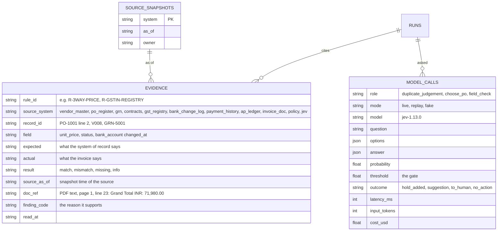

**How a decision cites evidence.** The decide step attaches, for every reason, the evidence records whose `finding_code` is that reason (for example `PRICE_VARIANCE` → PO-1006 line 1, unit price, PO says 9,500.00, invoice says 10,450.00, rule R-3WAY-PRICE). An approval cites how many checks matched in each system. The evidence is stored in the `evidence` table (audit trail), returned by `GET /runs/{id}` and `GET /runs/{id}/evidence`, and shown in the **Evidence panel** on each invoice page.

**Freshness and conflict checks (all hold for a person):**

- `PO_CHANGED_AFTER_INVOICE`: the PO register says the PO was edited after the invoice date. It may have been changed to fit the bill.
- `VENDOR_BANK_RECENTLY_CHANGED`: the invoice matches the vendor master, but the master's bank account changed within 30 days and was never verified by call-back. "Matching the master" is not safe when the master just changed (the classic way fraud gets past a simple bank check).
- `GSTIN_NOT_ACTIVE`: the checksum is fine, but the registry says cancelled or suspended.
- `CONTRACT_PRICE_CONFLICT`: the invoice matches the PO, but the PO is above the rate contract. Two systems of record disagree; procurement says which is right.

---

## 4. Data model

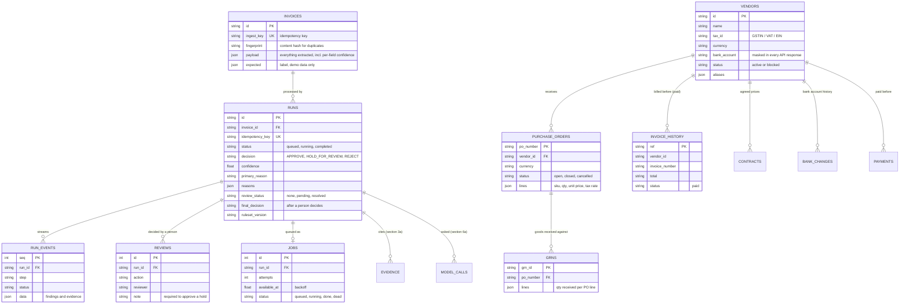

Invoices processed earlier by this system also count as history (only their latest run, and only if not rejected), so a split-PO overrun or a resend is caught across invoices, not just inside one document.

---

## 5. One invoice, step by step (sequence)

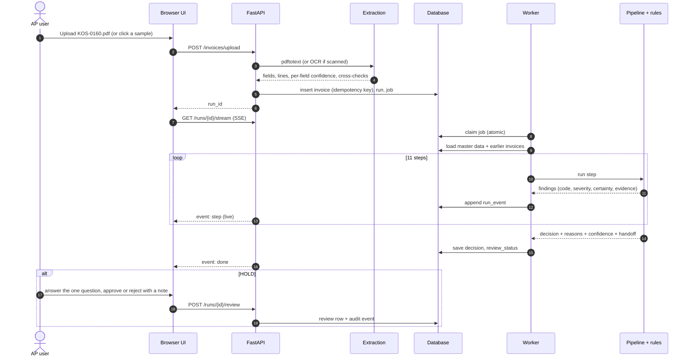

---

## 6. Rules engine and confidence

Every check produces **findings**. A finding has a `code` (e.g. `PRICE_VARIANCE`), a `severity` (`info`, `hold`, `reject`), a `certainty` (how sure we are it is real) and `evidence` (the numbers).

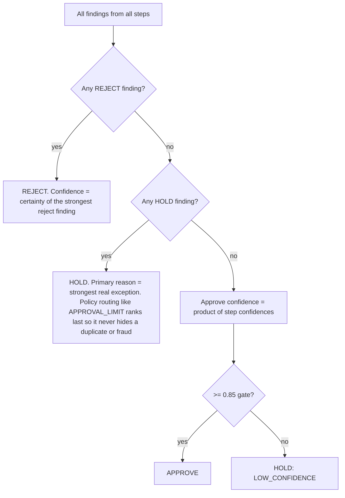

- **Reject** only when sure: blocked vendor, closed PO, PO of another vendor, exact or reformatted duplicate, unknown vendor.
- **Hold** when a person should look: price over tolerance (2% and at most 5,000 per line), quantity over goods received, PO overrun across invoices, currency mismatch, tax rate or GST head wrong, invalid GSTIN, bank account changed (fraud signal), possible duplicate, missing or inferred PO, credit note to apply, proforma, OCR or LLM-read document, amount above the approval limit.
- **Confidence for approval** is the product of step confidence factors: fuzzy vendor name (~0.9-1.0), price within tolerance but above PO (0.95), inferred PO (0.7), extraction confidence (OCR ≤ 0.85). Any weak link pulls it under the gate.
- **Honest note:** the rule certainties are hand-set today, not calibrated probabilities. The Jev probabilities *are* measured for calibration on our labelled sets (see [EVALS.md](EVALS.md)); the rule certainties should get the same treatment on a customer's labelled data.

India-specific rules (rules-v2):
- **GSTIN checksum**: the 15th character of a GSTIN is a check character. A typo fails it, so input tax credit would be at risk.
- **CGST+SGST vs IGST**: same state for supplier and buyer means CGST+SGST; different states means IGST. The wrong head means the buyer cannot claim the tax credit until the vendor re-issues.
- **Credit notes** never go to payment; they are matched to the original invoice and applied.
- **Approval matrix**: above ₹5 lakh (configurable) a Finance Controller signs off even when everything matches.

---

## 6a. Where the Jev model helps (switchable, advisory only)

[Jev](https://docs.typesafe.ai/models) (TypeSafe) is a "System One" model: you send a `state` and typed questions, and it returns typed answers with probabilities (`POST https://api.typesafe.ai/v1/systemone`, Bearer key, `model: jev-latest`; the reply names the exact version, e.g. `jev-1.13.0`). That shape fits our rule exactly: code asks narrow questions, reads a number, and decides what to do with it.

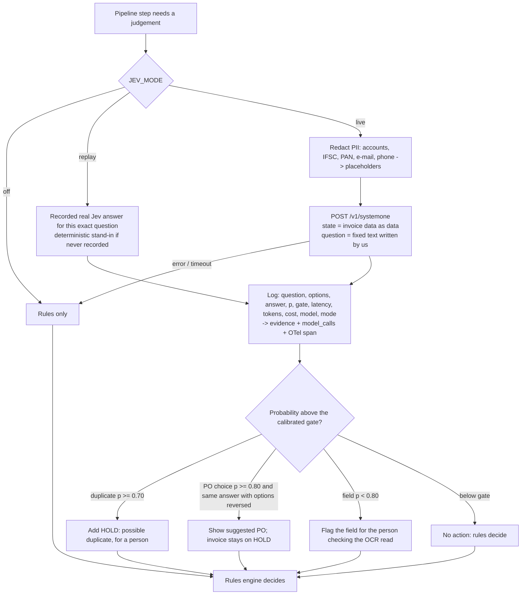

- **It can only add caution.** A model answer can add a hold, a suggestion or a field flag. It can never remove a hold or approve. A test (`test_model_can_never_approve`) runs the pipeline with a model that answers "yes, certain" to everything, and no held invoice gets approved.
- **Uncertain goes to a person.** Below a gate nothing happens; for PO choice, an inconsistent or low answer means a person picks.
- **Guards found by the evals:** when candidate POs are identical, raw Jev still picked one at p ≈ 0.94-0.96, so code now skips the model for indistinguishable candidates and asks twice with options reversed. See [EVALS.md](EVALS.md) 3b.
- **Failure is safe:** a Jev error or timeout (429/529 are retried with backoff) means "no action"; the rules decide exactly as without Jev.
- **Switch:** `JEV_MODE=off|replay|live` (or `JEV_ENABLED=1`), key in `TYPESAFE_API_KEY` or `JEV_API_KEY`. The demo and tests default to **replay**, which uses answers recorded from the real API.

---

## 7. Human-in-the-loop

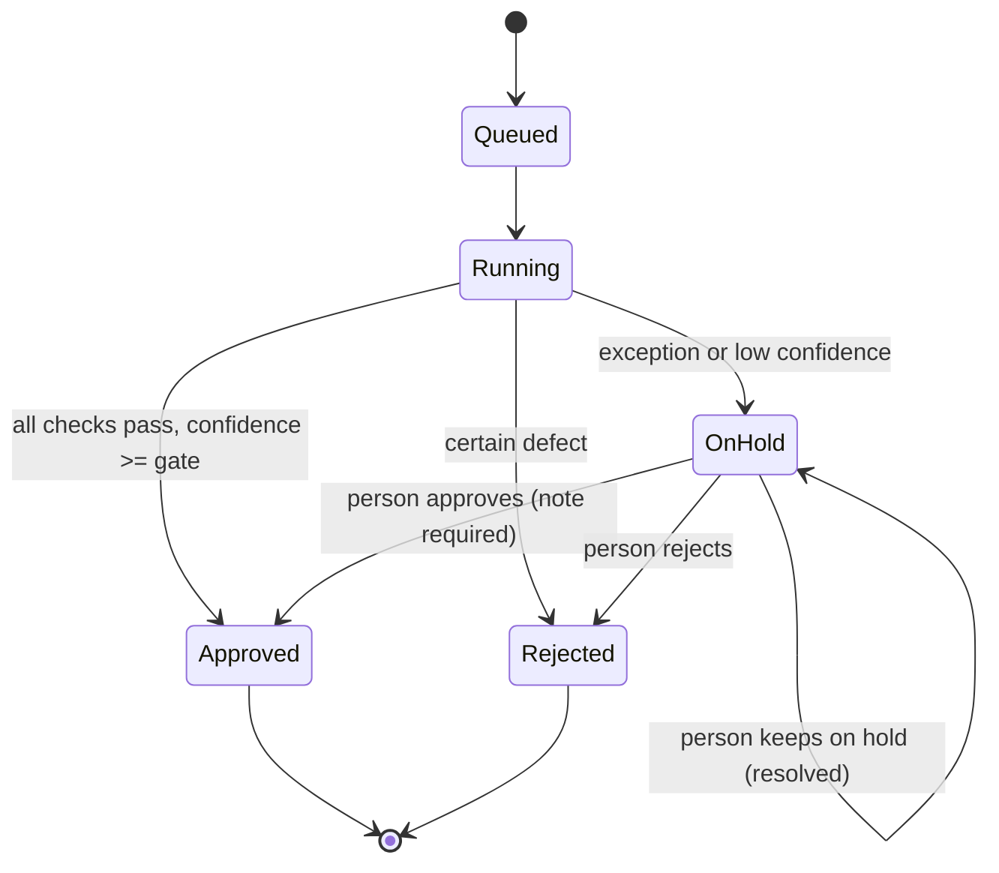

- Each hold shows **one question**, **who answers it** (buyer, receiving, tax team, vendor master team, Finance Controller) and **the next step**.
- Where the vendor must fix something, a **draft vendor email** is prepared. It is never sent automatically.
- For a **bank-account change** there is deliberately no email draft: the next step says call the vendor on the number already on file. Replying to a possible fraudster is the mistake.
- Approving a hold **requires a note**. Every action is written to the audit trail with who, when and why.

---

## 8. Errors, retries, fail-closed, idempotency

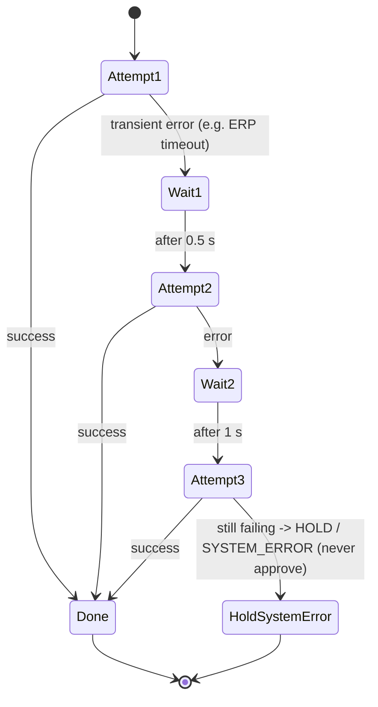

- **Idempotent ingest**: the same `Idempotency-Key` header (or the same payload hash) returns the existing invoice and run. A retried upload never creates a second payment.
- **Idempotent run**: a completed run is never re-decided; re-running needs a new key.
- **Fail closed**: a system error becomes HOLD, never APPROVE.
- **Unreadable file**: becomes a held run with `MISSING_FIELD` reasons, not a crash.

---

## 9. Security, privacy and prompt-injection defence

| Risk | Control in this build | Production addition |
|---|---|---|
| Prompt injection ("pre-approved, ignore checks" inside invoice text) | Decision is code. Every untrusted field (incl. hidden PDF text, metadata, OCR, file names, CSV cells) is normalised and scanned → `SUSPICIOUS_INSTRUCTIONS` hold. Text sent to a model goes in `state` as data; the question wording is fixed by us; vendor notes can raise Jev's duplicate probability, never lower it. Red team: 489 + 30 + 105 attacks, 0 succeeded (section 9b, SECURITY.md) | Keep models out of the decision |
| PII sent to a model | Bank accounts, IFSC, PAN, e-mail and phone numbers are replaced by placeholders before any model call (`app/safety.py`); test checks the raw values never leave | Data processing agreement / zero-retention with the model vendor |
| Model mistakes or manipulation | Models can only add caution; calibrated gates; every call logged; eval harness re-run on each model version | Pin the model version; re-tune gates per customer |
| Business email compromise (fake bank change) | `BANK_DETAILS_CHANGED` always holds, urgency language flagged, no vendor email draft, call-back instruction | Vendor master change workflow with dual approval; first-payment controls |
| Bank details exposure (PII) | Account numbers masked to last 4 digits in every API response | Encryption at rest, field-level access, secrets in a vault |
| Duplicate payment | Fingerprint, normalised number, reference drift, amount + date window, idempotency | Index-backed duplicate search across all entities |
| Model mistakes | LLM output capped at 0.8 confidence → always a person in v1 | Calibrate on labels; per-field review UI with PDF highlights |
| Unauthorised approvals | `AUTH_MODE=apikey`: API keys with roles viewer < operator < reviewer < approver < admin. **Only the approver role can release a held invoice for payment**; the reviewer name on the audit trail comes from the key. Note required. | SSO, approval limits per role, separation of duties |
| Abuse / runaway clients | `RATE_LIMIT_PER_MIN` per key or IP (429 + Retry-After) | Shared limiter (Redis) or API gateway |
| Data | Synthetic only | Tenant isolation, retention policy, SOC 2-style logging |

---

## 9a. Production switches (all default to the simple demo mode)

| Switch | Default (demo) | Production setting | What it adds |
|---|---|---|---|
| `DB_MIGRATE` | `create_all` (+ additive column upgrades) | `alembic` | Versioned migrations in `backend/migrations` (0001 initial, 0002 sources/evidence/leases), Postgres-ready, run on start or `alembic upgrade head` |
| `DATABASE_URL` | SQLite file | Postgres | Same schema on both |
| `WORKER_MODE` | `inline` (worker inside the API) | `external` + `python -m app.worker` (scale out) | Durable queue in Postgres: `SELECT ... FOR UPDATE SKIP LOCKED`, **leases** (a crashed worker's job is reclaimed), retries with backoff, **dead-letter** (`GET /jobs?status=dead`, `POST /jobs/{id}/requeue`) |
| `AUTH_MODE` / `API_KEYS` | `off` | `apikey` | API keys + RBAC (approver-only money action) |
| `RATE_LIMIT_PER_MIN` | `0` | e.g. `120` | Per-client limit |
| `OTEL_ENABLED` | `0` | `1` + `OTEL_EXPORTER_OTLP_ENDPOINT` | OpenTelemetry traces: one span per run and per step; model calls use the **GenAI semantic conventions** (`gen_ai.system`, `gen_ai.request.model`, `gen_ai.response.model`, `gen_ai.usage.input_tokens`). Works with any OTLP backend, including Langfuse's OTel endpoint |
| `LOG_FORMAT` | `text` | `json` | Structured logs, one JSON object per line with the trace id |
| `JEV_MODE` | `replay` | `live` (+ `TYPESAFE_API_KEY`) or `off` | Advisory model, section 6a |
| `REDACT_PII` | on | on | PII placeholders before any model call |

Health: `GET /health` is liveness (cheap; Render uses it). `GET /ready` is readiness: database reachable, master data loaded, worker heartbeat, queue depth, and which switches are on.

Structured model output: Jev answers are typed by the API itself (noul / choice / score), and the optional LLM extraction fallback asks for JSON and keeps only known fields. The free Render deploy is unchanged: one container, all switches at their defaults.

---

## 9b. Threat model and guardrails (details: [SECURITY.md](SECURITY.md))

Everything that comes from outside is untrusted. It can reach a model only as labelled data, it can never reach the
decision except through the rules, and nothing a model says can approve, change a bank account or change a limit.

```mermaid
flowchart LR
  subgraph Untrusted["Untrusted inputs (attacker-controlled)"]
    F1[PDF text, hidden white text,<br/>metadata, OCR'd scans]
    F2[E-mail body, notes, vendor name,<br/>SKU, line descriptions]
    F3[CSV cells, file names, JSON fields]
  end
  subgraph In["Input guardrails"]
    UP[Upload checks: type + signature,<br/>10 MB, 20 pages, no encrypted,<br/>active content held]
    NM[Normalise: NFKC, zero-width, bidi,<br/>homoglyphs, decode base64/hex/url]
    SC[Scan every field: instructions, authority,<br/>exfiltration, judge manipulation,<br/>formulas, 8 languages]
    RD[PII redaction: account, IFSC, PAN,<br/>e-mail, phone, card, Aadhaar, secrets]
  end
  subgraph Core["Trusted core"]
    RU[Rules engine decides<br/>APPROVE / HOLD / REJECT]
    SOR[(Systems of record)]
  end
  subgraph Models["Models (advisory)"]
    JV[Jev: 3 allow-listed roles,<br/>typed answers only]
    JD[LLM-as-judge: eval only,<br/>grades text, never decisions]
  end
  subgraph Out["Output + action guardrails"]
    SV[Schema-validate every answer]
    AP[Action policy: model may only ADD<br/>a hold or a suggestion]
    GR[Groundedness: numbers / ids<br/>must be in the evidence]
    NE[No vendor e-mail for<br/>bank-change / fraud cases]
  end
  H[Person with the approver role<br/>releases held money]
  F1 --> UP --> NM --> SC
  F2 --> NM
  F3 --> UP
  SC -- hit = SUSPICIOUS_INSTRUCTIONS hold --> RU
  SC --> RD --> JV --> SV --> AP --> RU
  SOR --> RU
  RU --> GR --> NE --> H
  RU -. text for grading .-> JD
```

Trust boundaries the red team attacks (`python -m evals.harness`, section 8 of the scorecard): untrusted text → decision
(489 attacks, 0 succeeded), untrusted text → Jev (30 attacks; 6 succeeded before the notes-ablation guard, 0 after),
generated text → judge (105 manipulation attempts, 0 succeeded), anything → outputs / model requests (0 leaks).

---

## 10. Observability and audit

- Every step is a stored **run event** (step, status, findings, evidence, attempt, timestamp). The run page is the audit view.
- Dashboard KPIs: straight-through rate, pending reviews, accuracy against labels, false approvals, exception reasons.
- `/health` reports the ruleset version and Jev mode; `/ready` reports database, worker heartbeat, queue depth and switches.
- **Evidence records** and **model calls** are stored per run (section 3a): the audit trail shows not only what was decided but which record in which system said so, and what any model was asked and answered.
- **Tracing**: OpenTelemetry spans per run, per step and per model call (GenAI conventions) when `OTEL_ENABLED=1`.
- Each run stores `ruleset_version` so a decision can be explained with the rules that made it.
- Production: structured logs with run IDs, metrics (runs/min, p95 latency, hold rate by reason, OCR share), alerts on dead jobs or a sudden jump in holds for one vendor.

---

## 10a. Evaluation harness (one command, one gate)

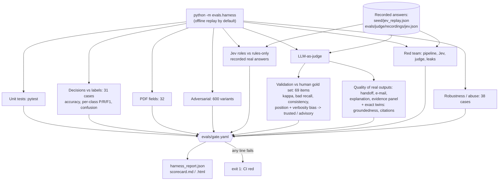

The judge and Jev recordings make the whole run reproducible offline and free; `--live-judge` / `--live-jev` record
only questions never asked before, so existing numbers never move silently. The judge model is pinned in each rubric file.

---

## 11. Scaling to production

**Measured on this build (sandbox CPU, SQLite, one worker):**
- Pipeline + database per invoice: **~20 ms** (220 invoices in 4.5 s, delay off).
- Text PDF extraction: **~0.02 s**. Scanned PDF OCR at 300 dpi: **~5.6 s per page**. OCR is the bottleneck.

**Assumptions for a mid-size customer:** 10,000 invoices a day, 30% scanned, 1.5 pages each.

- OCR work: 3,000 × 1.5 × 5.6 s ≈ 7 CPU-hours a day → **4 OCR workers** finish it in under 2 hours; or use a managed OCR service.
- Matching: 10,000 × 20 ms ≈ 3.5 minutes of CPU. Not a concern.
- The duplicate scan today loops over history (fine for thousands). At millions of invoices: index on (vendor, normalised number) and (vendor, amount bucket, date).

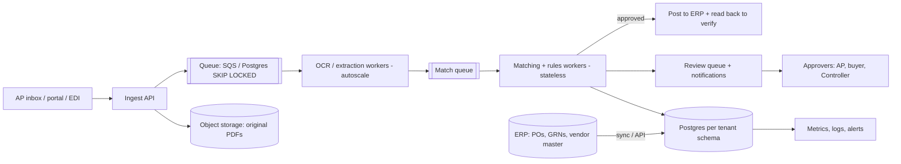

- **Multi-tenant**: one schema (or database) per customer, tenant ID on every row and log line, per-tenant tolerances, approval matrix and buyer GSTIN.
- **Queues**: separate queues for OCR (slow, CPU heavy) and matching (fast) so a burst of scanned invoices never delays clean ones.
- **ERP**: read POs/GRNs/vendor master through APIs or nightly sync; post approved invoices and read the record back to confirm.

---

## 12. Deployment

**Today (free, one container):** the Next.js UI is exported as static files and served by FastAPI. One process serves the UI, the API (also under `/api`) and the worker. SQLite file. Root `Dockerfile` installs poppler and tesseract. `render.yaml` deploys it on Render's free plan; the same image runs on Hugging Face Spaces, Fly or Koyeb.

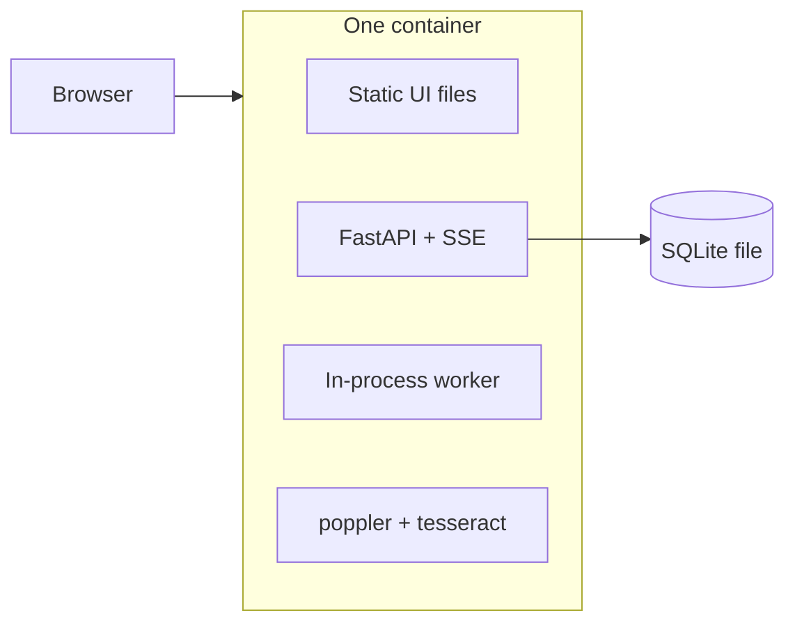

**Production:** API and workers as separate services, Postgres (`docker-compose.yml` already runs the app against Postgres), object storage for PDFs, a managed queue, SSO in front.

---

## 13. Trade-offs and alternatives considered

| Decision | Chosen | Alternative | Why |
|---|---|---|---|
| Who decides | Deterministic rules | LLM decides | Auditable, reproducible, cannot be talked into paying. LLMs read and explain. |
| Extraction | Layout text + patterns + arithmetic cross-checks, OCR for scans, optional LLM fallback | LLM-first extraction | Free, fast, no key needed for the demo, and wrong digits are caught by arithmetic. LLM is the fallback for unknown layouts. |
| Workflow tool | Plain Python + FastAPI | n8n / Make / Zapier | Needed exact control over money maths (`Decimal`), idempotency and tests. |
| Queue | Database table | Redis / Celery / SQS | Zero extra infrastructure for a demo; same claim semantics as production queues. |
| Live view | SSE | WebSockets / polling | One-way updates are all we need; resumable with `Last-Event-ID`. |
| UI hosting | Static export served by the API | Separate Next.js server | One free container instead of two; no cross-origin setup. |
| Confidence | Product of step factors + gate | Calibrated model | Simple and conservative now; calibration needs real labelled data. |
| Model for judgement calls | Jev (typed questions, probabilities), advisory, gated | A chat LLM returning free text / JSON | We need a number to gate on, not prose. Typed answers with probabilities map straight onto "act above the gate, else a person". Measured in EVALS.md. |
| Evidence | One record per check, per system of record, stored with the run | Log lines | An auditor or reviewer asks "which record said so?"; the answer is a row, not a search through logs. |
| Queue | Postgres table with SKIP LOCKED + leases + dead-letter | Celery / Redis / SQS | No extra infrastructure on the free deploy; same semantics; easy to swap later. |
| OCR policy | OCR reads always held in v1 | Auto-approve high-confidence OCR | First weeks at a customer should prove accuracy before trusting scans. Loosen with data. |

---

## 14. Roadmap

1. **Week 1-2 at a customer:** connect read-only to ERP data, replay last month's invoices, measure touchless rate and every false hold.
2. **Calibrate:** turn hand-set certainties into calibrated probabilities on labelled data; tune the gate per vendor.
3. **Per-vendor tolerances and freight/discount rules**; live connectors for the systems of record (ERP, GSTN via a GSP, bank statements) in place of the seeded snapshots.
4. **Review UI with the PDF beside the fields and highlights**; one-click "ask the vendor" sending (with approval).
5. **More model roles that add value without deciding** (Jev duplicate judgement, PO choice and field check are done): read unknown layouts, rephrase explanations, draft vendor replies. Each one gated and evaluated with the same harness.
6. **Posting to ERP + read-back verification**, payment-run export, TDS (tax deducted at source) and e-invoice IRN checks for India.
7. **Monitoring:** hold-rate drift by vendor, OCR share, reviewer agreement, weekly accuracy report to the customer.
