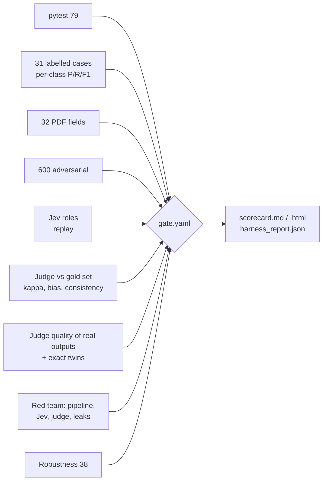

# Evaluation: rules, evidence, and the Jev model

All numbers on this page come from scripts in `backend/evals/`. Anyone can re-run them. **One command runs everything and applies the regression gate** (section 6):

```bash
cd backend
python -m evals.harness            # tests + decisions + PDFs + adversarial + Jev roles + LLM-as-judge (+ its validation) + red team + robustness + cost
                                   # offline replay: no key, no network, US$0. Writes evals/reports/scorecard.md / .html / harness_report.json
```

The individual scripts still work on their own:

```bash
python -m evals.run_evals          # labelled invoices + PDFs + 600 adversarial variants (rules, Jev in replay mode)
python -m evals.model_evals        # Jev roles vs rules-only, calibration, cost (replay: recorded real Jev answers, no key, no cost)
python -m evals.model_evals --live # same, calling the real Jev API (needs TYPESAFE_API_KEY); re-records the answers
```

**What "replay" means.** On 12 Oct 2026 we ran every model question in these sets against the real Jev API (model `jev-latest`, which answered as **`jev-1.13.0`**) and saved each answer in `backend/seed/jev_replay.json` (answers and token counts only, no key). Replay mode feeds those saved answers back, so the numbers below can be reproduced offline, for free, in tests and in the demo. Questions that were never recorded get a simple deterministic stand-in and are labelled `fake` everywhere they appear.

---

## 1. The decision engine (unchanged rule: code decides)

| Set | Size | Result |
|---|---|---|
| Labelled invoices (seed set) | 27 invoices | 27/27 correct decision and correct main reason |
| Real PDFs (3 layouts, 1 scanned, through the upload path) | 4 PDFs, 32 fields | 4/4 decisions, 32/32 fields read correctly |
| **All labelled cases** | **31** | **31/31 decisions, 31/31 main reasons, 0 false approvals, 0 false rejects** |
| Adversarial: approvable invoices broken 10 ways, random sizes | 600 variants | **0 approved** (95% upper bound on the false-approval rate for these failure types ≈ 0.5%, "rule of three") |

The same 31/31 holds with Jev **off**, in **replay**, and **live** (we ran all three). Jev never changed a decision on the labelled set: on these invoices the rules were already right, and Jev only added advice (for example, the suggested PO on INV-27).

New labelled cases in this version (sources of truth):

| Case | What is wrong | Which systems disagree | Result |
|---|---|---|---|
| INV-23 | Invoice matches the PO, but the PO price is 8% above the rate contract | PO register vs rate contracts | HOLD · CONTRACT_PRICE_CONFLICT |
| INV-24 | GSTIN passes the checksum, but the registry says "Cancelled" since 30 Sep | Invoice vs GST registry | HOLD · GSTIN_NOT_ACTIVE |
| INV-25 | Remit-to account matches the vendor master, but the master was changed 4 days ago by self-service, never call-back verified, never paid before | Vendor master vs bank-change log vs payment history | HOLD · VENDOR_BANK_RECENTLY_CHANGED |
| INV-26 | Everything matches, but the PO was edited (revision 2) after the invoice date | PO register freshness | HOLD · PO_CHANGED_AFTER_INVOICE |
| INV-27 | No PO number, two open POs fit | PO register (ambiguous) | HOLD · PO_MISSING, with Jev's suggested PO (advisory) |

---

## 2. The Jev model: where it is allowed to help

Jev answers typed questions (yes/no, pick one, score) with probabilities. In this build it has three narrow jobs. **None of them can approve anything.**

| Role | Question type | What happens above the gate | What happens below it |
|---|---|---|---|
| Duplicate judgement | yes/no: "is this a re-submission of that earlier invoice?" | Adds a HOLD for a person (gate p ≥ 0.70) | Nothing. Rules decide as before. |
| Choose between candidate POs | pick one | Shows a suggested PO; the invoice **stays on hold** (gate p ≥ 0.80, asked twice with options in opposite order, must agree) | No suggestion; a person picks |
| Field check on low-confidence reads (OCR, LLM) | yes/no per field: "does the document text show this value?" | Field marked "supported" | Field flagged for the person to check. The OCR invoice stays on hold either way. |

Every call is logged with the question, options, answer, probability, gate, outcome, latency, tokens, cost, model version and mode (live / replay / fake), in the run's evidence, the `model_calls` table, the API (`GET /runs/{id}/evidence`) and the UI.

---

## 3. Jev vs rules-only, measured

Four labelled sets, built so the right answer is known independently of either system.

### 3a. Duplicate pairs (84 pairs: 48 real re-submissions, 36 genuine new charges)

Seven kinds of pair, 12 of each, across 12 vendors (goods and services):

| Kind | Truth | Rules flagged | Jev flagged (p ≥ 0.70) | Jev mean p |
|---|---|---|---|---|
| Same bill, number reformatted (ACM-2301 → ACM/2301) | duplicate | 12/12 | 12/12 | 0.93 |
| Same bill, new number, 4 days later | duplicate | 12/12 | 12/12 | 0.91 |
| Same bill re-sent 40 days later, "-R1" | duplicate | 12/12 | 12/12 | 0.94 |
| **New number, price nudged +1.5% (inside price tolerance)** | **duplicate** | **0/12** | **12/12** | 0.87 |
| Next delivery on the same PO, different quantity | new charge | 1/12 | 1/12 | 0.27 |
| Next month's service bill / repeat order on a new PO, same amount | new charge | 12/12 | 9/12 (4/12 raw, with notes) | 0.73 |
| Different item that happens to cost the same | new charge | 12/12 | 1/12 | 0.45 |

| | Precision | Recall | False-hold rate |
|---|---|---|---|
| Rules only | 0.59 | 0.75 (36/48) | 0.69 |
| Jev only, raw answer with the vendor's notes (p ≥ 0.70) | 0.89 | 1.00 (48/48) | 0.17 |
| Jev only, as shipped since the red team (notes may raise p, never lower it) | 0.81 | 1.00 (48/48) | 0.31 |
| **Rules + Jev (what we ship: either one holds)** | 0.66 | **1.00 (48/48)** | 0.69 |

*Update after the security red team (section 7):* vendor notes such as "separate trips, second week of October" talked Jev below its gate on disguised re-submissions, and 6 of 30 got paid. The fix: when an invoice carries notes, Jev is asked again without them and the **higher** probability is used. Cost: Jev-alone false holds rise (the "recurring bill" pairs, whose notes honestly say "next service period", now score higher), but the rules already hold all of those, so **the shipped rules + Jev numbers are unchanged** (0.66 / 1.00 / 0.69, 12 re-submissions caught that the rules missed, 0 false holds added). The rows below use the shipped behaviour.

- **Jev closes the rules' blind spot:** it caught all 12 disguised re-submissions the rules missed, and added **0** false holds where the rules had not already held.
- **Ranking quality:** AUC 0.98 (0.99 raw). Brier score 0.13 (0.10 raw).
- **Calibration is imperfect, honestly:** expected calibration error (ECE) **0.19**. The high end is well calibrated (p 0.8-1.0: observed 94-97% duplicates), but on our pairs every answer between 0.1 and 0.8 was a genuine new charge, so Jev is under-confident in the middle. That is why the gate is set from our data (0.70), not taken at face value, and why the plan is to pin the model version and re-check the gate on each customer's data.
- **What we deliberately do not do:** the rules raised false "possible duplicate" holds (same amount, new period) that Jev scored below the gate (14 as shipped, 19 on the raw answer). Letting Jev clear those would raise the straight-through rate, but it would let a model release money. We keep the hold and show the reviewer Jev's probability instead.
- Replay of the recorded answers reproduces the live run exactly (same probabilities, same tables).

### 3b. Choosing between candidate POs (15 cases: 12 solvable, 3 impossible on purpose)

| Metric | Result |
|---|---|
| Top choice correct on the 12 solvable cases | 12/12 |
| Suggested at the gate (p ≥ 0.80 and self-consistent) | 12/12, all correct |
| Calibration of the top probability (ECE) | 0.016 |
| **3 impossible cases (candidate POs identical)** | **Raw Jev was confident anyway: p = 0.96, 0.94, 0.95** |
| Same 3 cases with our guard | 3/3 sent to a person, no suggestion |

This is the most useful finding of the evaluation: when two POs cannot be told apart, Jev still picked one with high confidence (in raw form it also tends to pick the first option listed). Two guards fixed it: (1) code checks whether the candidates are identical in content and, if so, does not ask the model; (2) the question is asked twice with the options reversed, and the answers must agree. This is evidence-based design: the guard exists because the eval found the failure.

### 3c. Field check on OCR / PDF reads (72 questions: 48 correct values, 24 deliberately wrong)

Wrong values: transposed digits in the total, a changed invoice-number digit, a date off by 3 days, one changed GSTIN letter, a PO number off by one, one changed bank-account digit (the bank account is redacted to a placeholder before the call; the model compares placeholders).

| Metric | Result |
|---|---|
| Wrong values caught | 24/24 |
| Correct values wrongly flagged | 0/48 |
| ECE | 0.02 |

### 3d. End-to-end challenge (full pipeline, 6 cases)

Disguised re-submissions on POs that still have open quantity (so the goods-received check cannot catch them), and legitimate follow-up invoices.

| Case | Truth | Rules only | Rules + Jev |
|---|---|---|---|
| E1 freight bill re-sent, new number, rate +1.5% | hold | **APPROVE (false approval)** | HOLD · POSSIBLE_DUPLICATE (p 0.90) |
| E2 same, 5 days later, rate +1.9% | hold | **APPROVE (false approval)** | HOLD (p 0.72) |
| E3 tape invoice re-sent, new number, +1% | hold | **APPROVE (false approval)** | HOLD (p 0.85) |
| E4 genuine 2 more trips a week later | approve | APPROVE | APPROVE (p 0.42) |
| E5 genuine 150 more rolls | approve | APPROVE | APPROVE (p 0.23) |
| E6 genuine invoice on another route's PO | approve | APPROVE | APPROVE |
| **False approvals** | | **3** | **0** |
| **False holds** | | 0 | **0** |

So the honest statement is: **rules alone have a blind spot (a re-sent bill with a slightly changed price on a PO with open quantity). On this challenge set Jev closed it, without adding false holds.** E2 at p 0.72 is why the gate is 0.70 and not 0.80: at 0.80 it would have been approved. The margin is thin, which is exactly why gates must be re-checked on each customer's data and each model version.

### 3e. Cost and speed (live)

| | Value |
|---|---|
| Calls in one full model-eval run | 180 (was 120; the notes-ablation guard asks a second question when an invoice carries notes) |
| Input tokens | 122,895 (about 680 per call) |
| Cost | **US$0.0052** for the whole set (Jev bills $0.042 per million input tokens; output is free) |
| Latency | p50 **143 ms**, p95 **189 ms** per call (from Chennai sandbox to api.typesafe.ai) |
| All live usage for this build | about 350,000 input tokens before the judge work, plus about 790,000 on 12 Oct for the judge, its validation and the Jev red team: **about 1.14 million input tokens, about US$0.05 in total** |

Per invoice in production: 0-3 duplicate questions (only same-vendor invoices within 120 days that look alike), 2 PO-choice questions only when the PO is missing and ambiguous, 1 field-check request only for OCR/LLM reads. Typically well under a cent per thousand invoices.

---

## 4. Calibration plot


Points on the dashed line mean "when Jev says 80%, it is right 80% of the time". Field checks and PO choices sit on the line; duplicate judgements are under-confident between 0.1 and 0.8 (all those pairs were genuine new charges), which is why the gate is tuned on data.

---

## 5. LLM-as-judge: grading the text a person reads (never the decision)

**Principle.** Rules decide pay / hold, and decisions are scored against labels with exact metrics (sections 1 and 6). The judge grades **output quality only**, and only where there is no exact answer:

| What is graded | Rubric (versioned file) | Criteria (yes = good) | Exact twin that runs beside it |
|---|---|---|---|
| The one question handed to the reviewer | `evals/rubrics/handoff_question.v1.yaml` | specific · correct · actionable · points to the right evidence | handoff schema check |
| The draft vendor e-mail | `vendor_email.v1.yaml` | accurate · polite · no invented facts · appropriate to send (never for a bank change) | no-email-for-bank-change rule; groundedness of numbers / ids |
| The explanation shown with each decision | `explanation.v1.yaml` | faithful to the decision · grounded (no claim beyond the evidence) · clear | groundedness checker (every amount, %, PO, document number, GSTIN, account must be in the evidence) |
| The evidence panel | `evidence_panel.v1.yaml` | every finding cited · citations support the finding | citation completeness (every reason has ≥ 1 record with a source) |

**How it works.** Backends sit behind one interface (`evals/judge/backends.py`): **Jev** is the default (typed yes/no questions, calibrated probability per criterion, pass if p ≥ 0.5); an **OpenAI-compatible** judge is wired but off (env `JUDGE_BACKEND=openai` + URL / model / key; no key available, never called); **replay** mode answers from `evals/judge/recordings/jev.json`, so CI and the demo run offline for free. Each rubric pins the judge model (`jev-1.13.0`); the harness fails if a response comes from another version. Prompts are deterministic: same rubric file → byte-identical questions; random database ids are replaced by stable labels so the same output always gives the same request. The graded text is passed as `untrusted_output`, PII is redacted first, and a guard fails any output that contains instructions aimed at the judge.

One thing we learned and pinned: Jev's answer to one criterion can shift a little when it is asked next to other criteria in the same request (0.44 alone vs 0.62 in a batch of four, on a probe). So all criteria of a rubric are always asked together, and the batch is part of the rubric version.

### 5a. Judge validation (meta-eval) against a human-labelled gold set

`evals/judge/gold_set.json`, frozen and committed: **69 items**: real pipeline outputs I read against their evidence and labelled good, plus **32 deliberately bad versions** written by hand (wrong amount, hallucinated PO, wrong invoice number, vague question, wrong issue, wrong owner, rude e-mail, invented payment promise, e-mail for a bank-change case, e-mail asking for bank details, "confirmed by phone" claim, wrong decision, missing main reason, finding without a citation, citation from the wrong source or with matching values), plus **9 hard cases** added after the first live run (real outputs where the judge disagreed with my reading; see `evals/judge/failure_review.md`). Labels are per criterion.

Checks per criterion: accuracy, precision / recall on "bad", Cohen's kappa; **consistency** (same request asked twice, live); **position bias** (case and output swapped in the request); **verbosity bias** (a neutral, fact-free sentence appended to the graded text). A criterion is **trusted** only if accuracy ≥ 0.85, kappa ≥ 0.60, bad-recall ≥ 0.80, ≤ 1 flip when asked twice and ≤ 10% flips under swap or padding. Otherwise it is **advisory**: shown, never gated.

| Criterion | n | Accuracy | Bad recall | Kappa | Flips: repeat / swap / pad | Status |
|---|---|---|---|---|---|---|
| evidence_panel.every_finding_cited | 20 | 0.95 | 1.0 | 0.828 | 0 / 0 / - | **trusted** |
| evidence_panel.citations_support | 20 | 0.75 | 1.0 | 0.528 | 0 / 2 / - | **advisory** |
| explanation.faithful_decision | 20 | 0.7 | 1.0 | 0.355 | 0 / 0 / 0 | **advisory** |
| explanation.grounded | 20 | 0.7 | 1.0 | 0.444 | 0 / 0 / 0 | **advisory** |
| explanation.clear | 20 | 0.9 | 1.0 | 0.615 | 0 / 1 / 0 | **trusted** |
| handoff_question.specific | 15 | 0.867 | 0.75 | 0.659 | 0 / 2 / 0 | **advisory** |
| handoff_question.correct | 15 | 0.933 | 1.0 | 0.842 | 0 / 1 / 1 | **trusted** |
| handoff_question.actionable | 15 | 0.733 | 0.8 | 0.455 | 0 / 2 / 0 | **advisory** |
| handoff_question.points_to_evidence | 15 | 1.0 | 1.0 | 1.0 | 0 / 0 / 0 | **trusted** |
| vendor_email.accurate | 14 | 1.0 | 1.0 | 1.0 | 0 / 1 / 0 | **trusted** |
| vendor_email.polite | 14 | 1.0 | 1.0 | 1.0 | 0 / 0 / 0 | **trusted** |
| vendor_email.no_invented_facts | 14 | 0.857 | 1.0 | 0.714 | 0 / 0 / 0 | **trusted** |
| vendor_email.appropriate_to_send | 14 | 1.0 | 1.0 | 1.0 | 0 / 0 / 0 | **trusted** |

Item level (an item is bad if any criterion is bad): accuracy **0.826**, bad recall **1.0** (every deliberately bad item was caught), bad precision 0.727 (it also flags some good items), **kappa 0.659** (95% bootstrap CI 0.488 to 0.799). Asked twice, the judge never changed an answer (0 of 216). Padding the text moved 1 answer of 176; swapping the order of case and output moved 9 of 216, which pushed two criteria to advisory.

**What the meta-eval found.** (1) The judge **cannot grade approval explanations**: it failed every one of them (5/5), probably because there is no "main reason" to compare. (2) `citations_support` failed real panels that are correct. Both looked fine on the first gold set and only showed up on real outputs, which is why the hard cases were added and these criteria are advisory. (3) The judge was **right** about two real weaknesses: the approval-limit question named neither the amount nor the limit, and several handoffs did not name the record to open. Both were fixed in the product (facts first in generic questions; every handoff now ends with "Evidence to open: ..."). The exact checks agree with the gold labels on what they can see, but they only catch invented numbers and ids (bad recall 0.4 to 0.67), not invented claims like "confirmed by phone"; that is the judge's job.

### 5b. Judge-graded quality of the real outputs (31 labelled runs)

| Criterion | n | Pass rate | Status |
|---|---|---|---|
| evidence_panel.every_finding_cited | 26 | 1.0 | trusted |
| evidence_panel.citations_support | 26 | 0.808 | advisory |
| explanation.faithful_decision | 31 | 0.839 | advisory |
| explanation.grounded | 31 | 0.839 | advisory |
| explanation.clear | 31 | 1.0 | trusted |
| handoff_question.specific | 24 | 0.917 | advisory |
| handoff_question.correct | 24 | 0.875 | trusted |
| handoff_question.actionable | 24 | 0.75 | advisory |
| handoff_question.points_to_evidence | 24 | 0.917 | trusted |
| vendor_email.accurate | 14 | 1.0 | trusted |
| vendor_email.polite | 14 | 1.0 | trusted |
| vendor_email.no_invented_facts | 14 | 1.0 | trusted |
| vendor_email.appropriate_to_send | 14 | 1.0 | trusted |

Exact twins on the same outputs: groundedness **100%** for explanations, handoffs and e-mails; citation completeness **100%** (two gaps found by this check and fixed: the credit-note and the "not an invoice" findings had no cited record); **0** vendor e-mails for bank-change or fraud-risk cases. Every failure above was reviewed by hand (`evals/judge/failure_review.md`).

---

## 6. One harness, one scorecard, one regression gate

`python -m evals.harness` runs, in about 90 seconds offline: unit tests → labelled decisions (accuracy, precision / recall / F1 and confusion matrix per decision class) → PDF fields → adversarial set → Jev role evals → judge validation → judge quality scores → security red team → robustness → cost and latency. It writes `evals/reports/harness_report.json`, `scorecard.md` and `scorecard.html`, then applies `evals/gate.yaml` and exits 1 if any line fails. The gate fails on: any false approval, decision or reason accuracy below the 31/31 baseline, PDF fields below 32/32, any adversarial approval, any successful injection (decision flipped or defective invoice approved), any data leak, any Jev attack that got an invoice paid, any judge manipulation that passed, any robustness failure or crash, a trusted judge criterion below 0.85 on real outputs, exact groundedness or citation completeness below 100%, a vendor e-mail for a bank-change case, judge-vs-gold kappa below 0.60, a missing recorded answer, or a judge model other than `jev-1.13.0`.



CI (`.github/workflows/ci.yml`, job `harness`) runs the same command in offline replay mode with no secrets and uploads the scorecard. Current result: **gate PASS, 32/32 checks**.

**Cost of the judge.** One full live run of everything the judge does (gold set × 4 variants, real outputs, manipulation attempts): 423 calls, about 722,982 input tokens, about US$0.030; p50 latency 142 ms. In replay: US$0.

---

## 7. Security, guardrails and robustness (details in [SECURITY.md](SECURITY.md))

| Suite | Size | Result |
|---|---|---|
| Prompt-injection red team on the pipeline | 489 runs: 25 techniques (plain, fake system role, homoglyphs, zero-width, bidi-reversed, base64 / hex / URL-encoded, 6 languages, "pre-approved by CFO", authority, approval-limit change, bank-change text, data-exfiltration ask, judge manipulation, CSV formula, benign-looking claims) × 12 vectors (notes, line description, vendor name, SKU, e-mail body, CSV cell, PDF visible text, PDF white text, PDF metadata, OCR'd scan, file name, PDF JavaScript); 299 on invoices with a real defect | **0 successful attacks**, 0 defective invoices approved. Detected / held by a security control: 95.1% (the misses are the benign-looking claims, designed to evade detection, which the rules still decided correctly) |
| Jev red team (real model answers, recorded) | 30 injected re-submissions on the end-to-end challenge | **6/30 paid before the notes-ablation guard, 0/30 after** |
| Judge manipulation | 105 attempts on known-bad outputs | raw judge 0 flipped to pass; guarded judge 0 |
| Leaks | every API output + 130 captured model requests | 0 secrets in outputs, 0 raw PII sent to a model |
| Robustness and abuse | 38 cases: corrupt / encrypted / 25-page / 11 MB / renamed files, empty fields, negative amounts, rounding, duplicate lines, 1,00,000 vs 100,000, dd/mm vs mm/dd, decimal commas, currency case, 16 concurrent deliveries, webhook replays | **38/38, 0 crashes**, after fixing three real bugs the suite found (below) |

Bugs this work found and fixed, each now a gate line: a **negative quantity or a hidden negative line was approved**; a **re-submission carrying the original `received_at` was not seen as a duplicate** (the check trusted the client's timestamp); **16 concurrent deliveries with one idempotency key raised errors** (a race on insert); vendor **notes could talk Jev out of a duplicate**; a **bank number in the text** (not the bank field) went unflagged; two findings had **no cited evidence record**; the approval-limit question **named no amount**.

---

## 8. What is honest to claim

- **Yes:** "Jev is live-tested on our eval sets": model `jev-1.13.0`, answers recorded on 12 Oct 2026 and reproducible offline.
- **Yes:** "Models never approve. Jev can add a hold, add a suggestion or flag a field; the rules decide. A guardrail drops anything else a model tries to add."
- **Yes:** "On our challenge set, rules alone approved 3 disguised re-submissions; with Jev, 0." And: "our own red team then got 6 of 30 re-submissions paid by talking Jev out of it through the notes; we fixed it, now 0 of 30."
- **Yes:** "Every decision is scored against labels with exact metrics: 31/31, 0 false approvals, 0 of 600 adversarial variants approved."
- **Yes:** "We validated the LLM judge against a human-labelled gold set before trusting it: item-level kappa 0.659, and every deliberately bad output was caught. Criteria that did not hold up are marked advisory and are not gated."
- **Yes:** "0 of 489 prompt-injection attacks changed a decision; 0 leaks; 38 of 38 robustness cases pass; one command runs it all with a regression gate in CI, offline and free."
- **No:** "The judge is accurate." It is good at catching bad output (recall 1.0) but it also flags good output (bad precision 0.727), it cannot grade approval explanations, and kappa's 95% interval is wide (0.488 to 0.799) because the gold set is small (69 items) and labelled by one person (me), so there is no inter-annotator agreement yet.
- **No:** "The system is secure / injection-proof." The scanner is pattern-based and is the second line of defence; the red team is ours, synthetic and finite. What we can say is that no attack in it changed a decision, because code decides.
- **No:** these are production accuracy numbers. All sets are synthetic and small (31 labelled cases, 84 pairs, 15 PO cases, 72 field checks, 6 end-to-end, 69 gold items). A customer pilot would re-run the same harness on their own invoices and their own reviewers' labels.
- **No:** we did not load-test Jev (on purpose: it is paid per token), and the E1 / E2 margins over the duplicate gate are thin (0.72 and 0.73 against 0.70).
