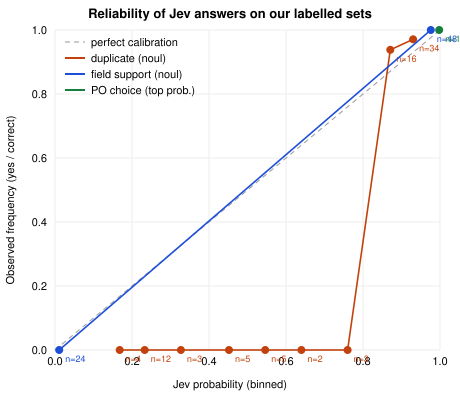

# Evaluation: rules, evidence, and the Jev model

All numbers on this page come from scripts in `backend/evals/`. Anyone can re-run them:

```bash
cd backend
python -m evals.run_evals          # labelled invoices + PDFs + 600 adversarial variants (rules, Jev in replay mode)
python -m evals.model_evals        # Jev roles vs rules-only, calibration, cost (replay: recorded real Jev answers, no key, no cost)
python -m evals.model_evals --live # same, calling the real Jev API (needs TYPESAFE_API_KEY); re-records the answers
```

**What "replay" means.** On 12 Oct 2026 we ran every model question in these sets against the real Jev API (model `jev-latest`, which answered as **`jev-1.13.0`**) and saved each answer in `backend/seed/jev_replay.json` (answers and token counts only, no key). Replay mode feeds those saved answers back, so the numbers below can be reproduced offline, for free, in tests and in the demo. Questions that were never recorded get a simple deterministic stand-in and are labelled `fake` everywhere they appear.

---

## 1. The decision engine (unchanged rule: code decides)

| Set | Size | Result |
|---|---|---|
| Labelled invoices (seed set) | 27 invoices | 27/27 correct decision and correct main reason |
| Real PDFs (3 layouts, 1 scanned, through the upload path) | 4 PDFs, 32 fields | 4/4 decisions, 32/32 fields read correctly |
| **All labelled cases** | **31** | **31/31 decisions, 31/31 main reasons, 0 false approvals, 0 false rejects** |
| Adversarial: approvable invoices broken 10 ways, random sizes | 600 variants | **0 approved** (95% upper bound on the false-approval rate for these failure types ≈ 0.5%, "rule of three") |

The same 31/31 holds with Jev **off**, in **replay**, and **live** (we ran all three). Jev never changed a decision on the labelled set: on these invoices the rules were already right, and Jev only added advice (for example, the suggested PO on INV-27).

New labelled cases in this version (sources of truth):

| Case | What is wrong | Which systems disagree | Result |
|---|---|---|---|
| INV-23 | Invoice matches the PO, but the PO price is 8% above the rate contract | PO register vs rate contracts | HOLD · CONTRACT_PRICE_CONFLICT |
| INV-24 | GSTIN passes the checksum, but the registry says "Cancelled" since 30 Sep | Invoice vs GST registry | HOLD · GSTIN_NOT_ACTIVE |
| INV-25 | Remit-to account matches the vendor master, but the master was changed 4 days ago by self-service, never call-back verified, never paid before | Vendor master vs bank-change log vs payment history | HOLD · VENDOR_BANK_RECENTLY_CHANGED |
| INV-26 | Everything matches, but the PO was edited (revision 2) after the invoice date | PO register freshness | HOLD · PO_CHANGED_AFTER_INVOICE |
| INV-27 | No PO number, two open POs fit | PO register (ambiguous) | HOLD · PO_MISSING, with Jev's suggested PO (advisory) |

---

## 2. The Jev model: where it is allowed to help

Jev answers typed questions (yes/no, pick one, score) with probabilities. In this build it has three narrow jobs. **None of them can approve anything.**

| Role | Question type | What happens above the gate | What happens below it |
|---|---|---|---|
| Duplicate judgement | yes/no: "is this a re-submission of that earlier invoice?" | Adds a HOLD for a person (gate p ≥ 0.70) | Nothing. Rules decide as before. |
| Choose between candidate POs | pick one | Shows a suggested PO; the invoice **stays on hold** (gate p ≥ 0.80, asked twice with options in opposite order, must agree) | No suggestion; a person picks |
| Field check on low-confidence reads (OCR, LLM) | yes/no per field: "does the document text show this value?" | Field marked "supported" | Field flagged for the person to check. The OCR invoice stays on hold either way. |

Every call is logged with the question, options, answer, probability, gate, outcome, latency, tokens, cost, model version and mode (live / replay / fake), in the run's evidence, the `model_calls` table, the API (`GET /runs/{id}/evidence`) and the UI.

---

## 3. Jev vs rules-only, measured

Four labelled sets, built so the right answer is known independently of either system.

### 3a. Duplicate pairs (84 pairs: 48 real re-submissions, 36 genuine new charges)

Seven kinds of pair, 12 of each, across 12 vendors (goods and services):

| Kind | Truth | Rules flagged | Jev flagged (p ≥ 0.70) | Jev mean p |
|---|---|---|---|---|
| Same bill, number reformatted (ACM-2301 → ACM/2301) | duplicate | 12/12 | 12/12 | 0.93 |
| Same bill, new number, 4 days later | duplicate | 12/12 | 12/12 | 0.91 |
| Same bill re-sent 40 days later, "-R1" | duplicate | 12/12 | 12/12 | 0.94 |
| **New number, price nudged +1.5% (inside price tolerance)** | **duplicate** | **0/12** | **12/12** | 0.87 |
| Next delivery on the same PO, different quantity | new charge | 1/12 | 1/12 | 0.27 |
| Next month's service bill / repeat order on a new PO, same amount | new charge | 12/12 | 4/12 | 0.52 |
| Different item that happens to cost the same | new charge | 12/12 | 1/12 | 0.45 |

| | Precision | Recall | False-hold rate |
|---|---|---|---|
| Rules only | 0.59 | 0.75 (36/48) | 0.69 |
| Jev only (p ≥ 0.70) | 0.89 | 1.00 (48/48) | 0.17 |
| **Rules + Jev (what we ship: either one holds)** | 0.66 | **1.00 (48/48)** | 0.69 |

- **Jev closes the rules' blind spot:** it caught all 12 disguised re-submissions the rules missed, and added **0** false holds where the rules had not already held.
- **Ranking quality:** AUC 0.99. Brier score 0.098.
- **Calibration is imperfect, honestly:** expected calibration error (ECE) **0.19**. The high end is well calibrated (p 0.8-1.0: observed 94-97% duplicates), but on our pairs every answer between 0.1 and 0.8 was a genuine new charge, so Jev is under-confident in the middle. That is why the gate is set from our data (0.70), not taken at face value, and why the plan is to pin the model version and re-check the gate on each customer's data.
- **What we deliberately do not do:** the rules raised 19 false "possible duplicate" holds (same amount, new period) that Jev scored below the gate. Letting Jev clear those would raise the straight-through rate, but it would let a model release money. We keep the hold and show the reviewer Jev's probability instead.
- Replay of the recorded answers reproduces the live run exactly (same probabilities, same tables).

### 3b. Choosing between candidate POs (15 cases: 12 solvable, 3 impossible on purpose)

| Metric | Result |
|---|---|
| Top choice correct on the 12 solvable cases | 12/12 |
| Suggested at the gate (p ≥ 0.80 and self-consistent) | 12/12, all correct |
| Calibration of the top probability (ECE) | 0.016 |
| **3 impossible cases (candidate POs identical)** | **Raw Jev was confident anyway: p = 0.96, 0.94, 0.95** |
| Same 3 cases with our guard | 3/3 sent to a person, no suggestion |

This is the most useful finding of the evaluation: when two POs cannot be told apart, Jev still picked one with high confidence (in raw form it also tends to pick the first option listed). Two guards fixed it: (1) code checks whether the candidates are identical in content and, if so, does not ask the model; (2) the question is asked twice with the options reversed, and the answers must agree. This is evidence-based design: the guard exists because the eval found the failure.

### 3c. Field check on OCR / PDF reads (72 questions: 48 correct values, 24 deliberately wrong)

Wrong values: transposed digits in the total, a changed invoice-number digit, a date off by 3 days, one changed GSTIN letter, a PO number off by one, one changed bank-account digit (the bank account is redacted to a placeholder before the call; the model compares placeholders).

| Metric | Result |
|---|---|
| Wrong values caught | 24/24 |
| Correct values wrongly flagged | 0/48 |
| ECE | 0.02 |

### 3d. End-to-end challenge (full pipeline, 6 cases)

Disguised re-submissions on POs that still have open quantity (so the goods-received check cannot catch them), and legitimate follow-up invoices.

| Case | Truth | Rules only | Rules + Jev |
|---|---|---|---|
| E1 freight bill re-sent, new number, rate +1.5% | hold | **APPROVE (false approval)** | HOLD · POSSIBLE_DUPLICATE (p 0.90) |
| E2 same, 5 days later, rate +1.9% | hold | **APPROVE (false approval)** | HOLD (p 0.72) |
| E3 tape invoice re-sent, new number, +1% | hold | **APPROVE (false approval)** | HOLD (p 0.85) |
| E4 genuine 2 more trips a week later | approve | APPROVE | APPROVE (p 0.42) |
| E5 genuine 150 more rolls | approve | APPROVE | APPROVE (p 0.23) |
| E6 genuine invoice on another route's PO | approve | APPROVE | APPROVE |
| **False approvals** | | **3** | **0** |
| **False holds** | | 0 | **0** |

So the honest statement is: **rules alone have a blind spot (a re-sent bill with a slightly changed price on a PO with open quantity). On this challenge set Jev closed it, without adding false holds.** E2 at p 0.72 is why the gate is 0.70 and not 0.80: at 0.80 it would have been approved. The margin is thin, which is exactly why gates must be re-checked on each customer's data and each model version.

### 3e. Cost and speed (live)

| | Value |
|---|---|
| Calls in one full model-eval run | 120 |
| Input tokens | 84,209 (about 700 per call) |
| Cost | **US$0.0035** for the whole set (Jev bills $0.042 per million input tokens; output is free) |
| Latency | p50 **143 ms**, p95 **189 ms** per call (from Chennai sandbox to api.typesafe.ai) |
| All live usage for this build (development + several full eval runs) | about 350,000 input tokens, about US$0.015 |

Per invoice in production: 0-3 duplicate questions (only same-vendor invoices within 120 days that look alike), 2 PO-choice questions only when the PO is missing and ambiguous, 1 field-check request only for OCR/LLM reads. Typically well under a cent per thousand invoices.

---

## 4. Calibration plot



Points on the dashed line mean "when Jev says 80%, it is right 80% of the time". Field checks and PO choices sit on the line; duplicate judgements are under-confident between 0.1 and 0.8 (all those pairs were genuine new charges), which is why the gate is tuned on data.

---

## 5. What is honest to claim

- **Yes:** "Jev is live-tested on our eval set": 120 live calls per model-eval run, plus the labelled set on 12 Oct 2026, model `jev-1.13.0`, results recorded and reproducible in replay.
- **Yes:** "The demo runs Jev in replay mode by default (recorded real answers). Live mode is one environment variable plus a key."
- **Yes:** "Models never approve. Jev can add a hold, add a suggestion or flag a field. The rules decide."
- **Yes:** "On our challenge set, rules alone approved 3 disguised re-submissions; with Jev, 0."
- **No:** these are synthetic, small sets built by us (84 pairs, 15 PO cases, 72 field checks, 6 end-to-end). They show the design works and how we measure it; they are not production accuracy. A customer pilot would re-run the same harness on their own invoices.
- **No:** we did not load-test Jev (on purpose: it is paid per token).
